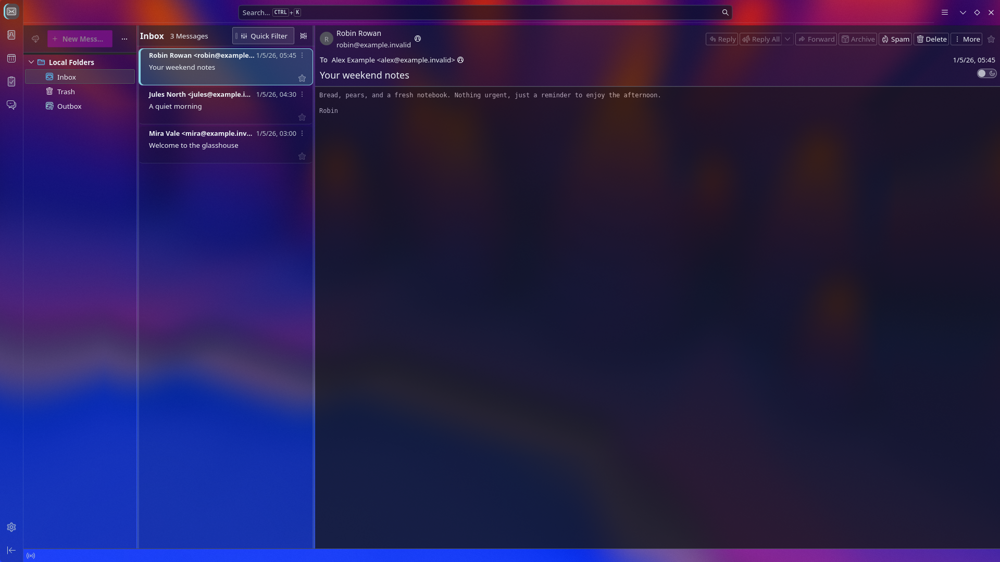
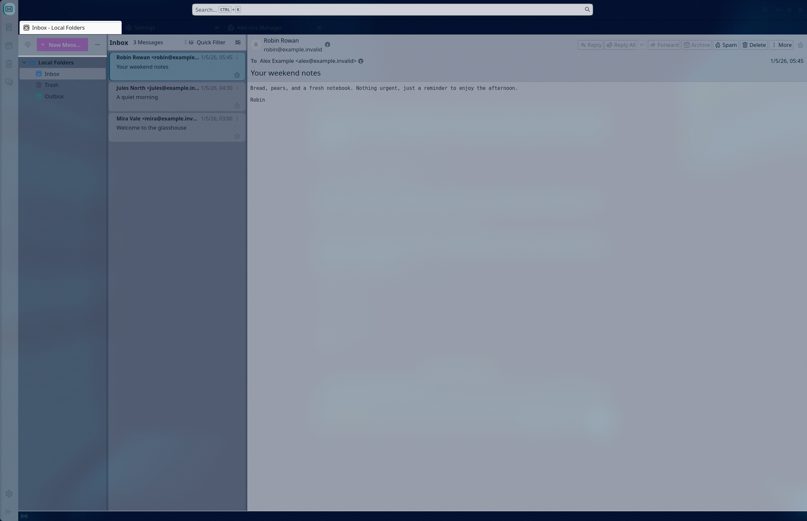
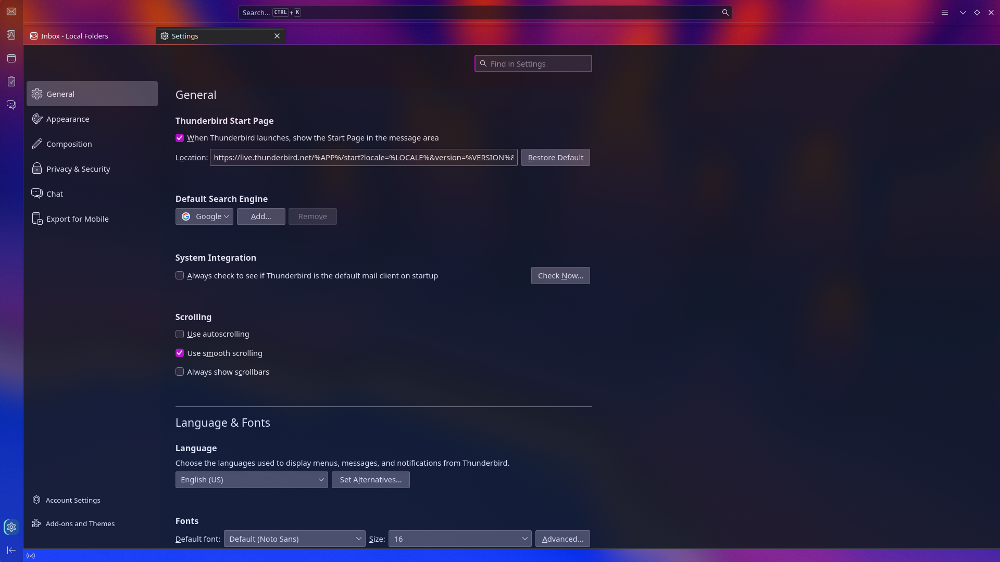
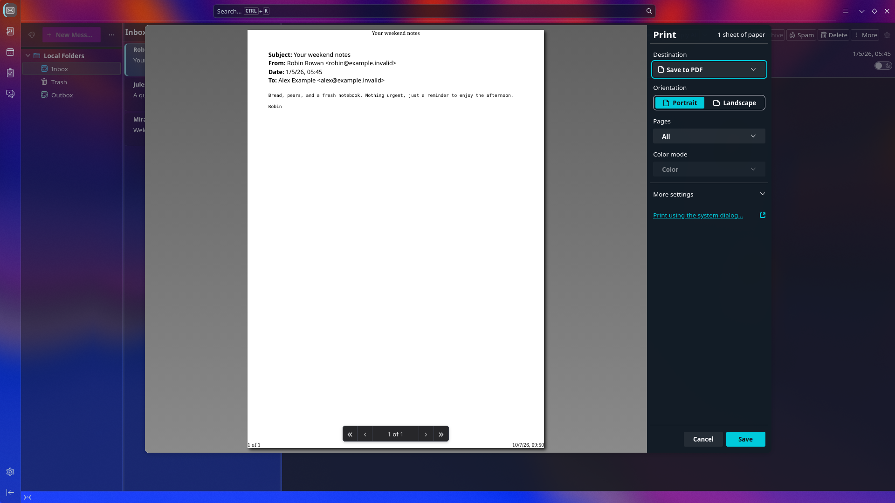

# Vesperwing Glass for Thunderbird

Vesperwing Glass pairs a lightweight light/dark Thunderbird theme with optional profile CSS for translucent mail surfaces. It is tuned for KDE Plasma and KWin, where the compositor supplies the blur behind the glass.

> **Two parts:** The XPI in Thunderbird’s theme catalog changes the supported theme colors. Thunderbird’s theme API cannot make every pane and message card transparent, so the full glass treatment requires the companion profile CSS in this repository.

## Screenshots

All screenshots use a separate Thunderbird profile populated only with fictional local messages. They contain no real accounts or mail.

| Dark three-pane layout | Light three-pane layout |
|---|---|
|  |  |

| Settings | Print preview |
|---|---|
|  |  |

## Install the theme

Use the adaptive package for most setups. It follows Thunderbird’s light/dark color scheme. Fixed light and dark packages are available for testing or for systems that do not follow the preferred scheme.

1. Download `dist/vesperwing-glass.xpi` from this repository, or build it locally.
2. In Thunderbird, open **Add-ons and Themes → Themes**.
3. Choose **Install Add-on From File…**, select the XPI, then activate **Vesperwing Glass for Thunderbird**.

Build all three packages with Python 3; no third-party packages are needed:

```sh
python3 build.py
```

The XPIs are written to `dist/`.

## Enable glass styling on Kubuntu / KDE Plasma

The companion CSS targets Thunderbird’s internal interface. It is independent of the theme XPI and needs to be installed into the profile where you use Thunderbird.

1. In Thunderbird, open **Help → Troubleshooting Information**. Beside **Profile Folder**, choose **Open Folder** and note the profile path.
2. Quit Thunderbird completely.
3. From the downloaded repository directory, run:

   ```sh
   python3 install.py install --profile "/path/to/your/profile"
   ```

   The installer backs up existing `userChrome.css`, `userContent.css`, `user.js`, and theme CSS files before adding its imports. It enables `toolkit.legacyUserProfileCustomizations.stylesheets` in `user.js` for you.
4. In **System Settings → Workspace Behavior → Desktop Effects**, enable **Blur**. Adjust its strength so wallpaper colors remain atmospheric without making text hard to read. Leave Thunderbird’s whole-window opacity at 100%; the CSS controls the transparency of individual surfaces.
5. Start Thunderbird again.

The supplied CSS covers the Spaces side rail, folder tree, message list and cards, message reader, toolbars, settings pages, and print controls. It includes light/dark colors plus reduced-transparency and high-contrast fallbacks. Message content retains its authored styling and is blended at 68% opacity, so text and images are also softened; set `opacity` to `1` for fully crisp message content. The print-preview paper and printed result remain native. KDE’s system file and print dialogs follow the system theme.

The selectors are tested against Thunderbird 157. Thunderbird may change its internal markup in later versions. The static XPI does not install or modify profile CSS; installing the XPI alone will not make every pane transparent.

### Restore your profile

Quit Thunderbird, then run:

```sh
python3 install.py restore --profile "/path/to/your/profile"
```

The installer refuses to overwrite profile files that changed after installation. Review those changes first; add `--force` only if you want to replace them with the saved backups:

```sh
python3 install.py restore --profile "/path/to/your/profile" --force
```

### KDE transparency notes

- Keep KWin compositing and the **Blur** desktop effect enabled. CSS exposes transparency; KWin blurs what is behind Thunderbird.
- Avoid lowering the opacity of the entire window, which fades text and icons along with the background.
- If you prefer a solid, more accessible interface, enable your desktop’s reduced-transparency preference or a high-contrast color scheme. The stylesheet also keeps message and settings content fully opaque in print mode.

## Files

- `manifest.json`, `manifests/` — the adaptive, light, and dark WebExtension themes.
- `styles/glass.css` — Thunderbird application chrome, panes, status bar, side rail, and glass states.
- `styles/content.css` — settings and print-control styling for `userContent.css`.
- `install.py` — backup-aware profile CSS installer and restore command.
- `build.py` — standard-library XPI builder.
- `dist/` — ready-to-install theme packages.

## Mozilla Add-ons

The adaptive theme is intended for [Thunderbird Add-ons](https://addons.thunderbird.net/). Its catalog description will call out that full glass styling uses the companion CSS from this repository. That distinction matters: the approved static theme API supplies colors for supported surfaces, while profile CSS reaches the panes and cards needed for this design.

## License

Source, styles, and theme manifests are released under the [0BSD license](LICENSE). The Thunderbird and KDE product names remain the property of their respective owners.

## References

- [Thunderbird WebExtension theme guide](https://developer.thunderbird.net/add-ons/web-extension-themes)
- [Thunderbird add-on review policy](https://thunderbird.github.io/atn-review-policy/)
- [Mozilla Add-ons submission guide](https://extensionworkshop.com/documentation/publish/submitting-an-add-on/)
- [KDE Plasma desktop effects](https://docs.kde.org/stable_kf6/en/kwin/kcontrol/kwineffects/index.html)
